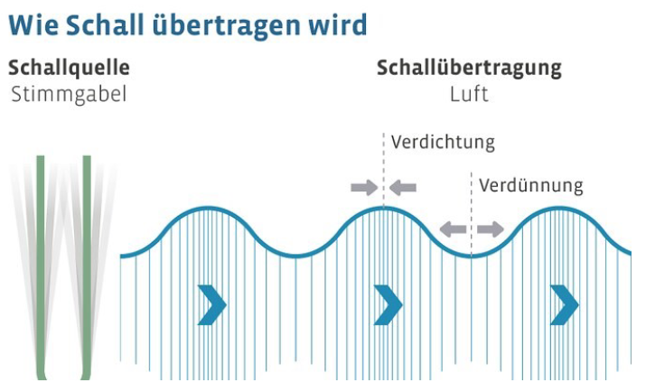
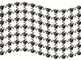
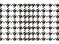
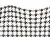
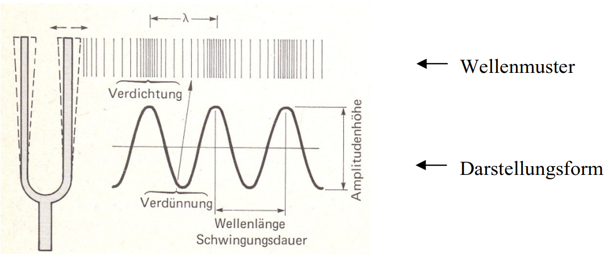
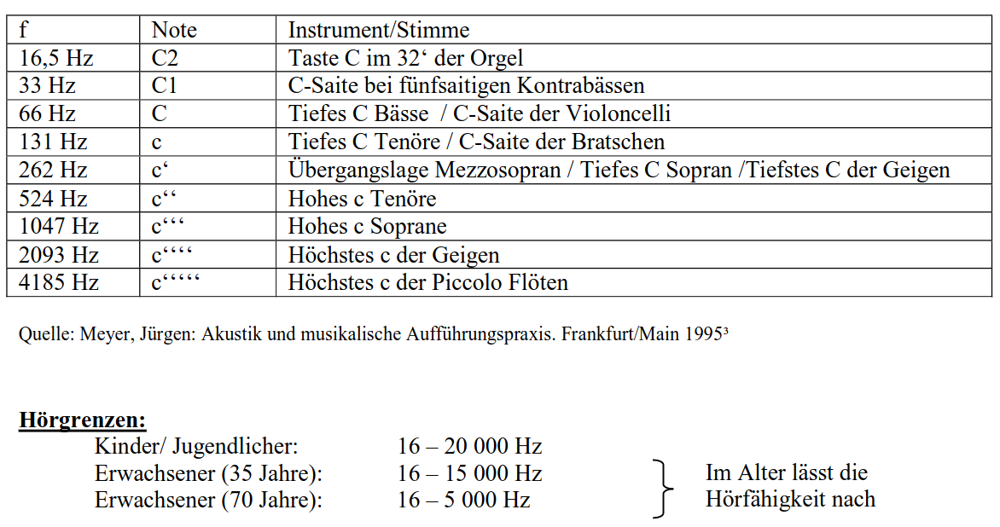
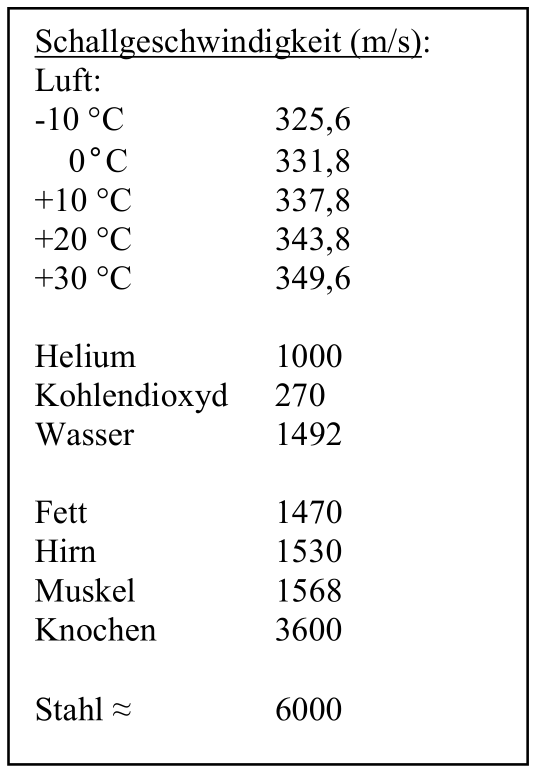
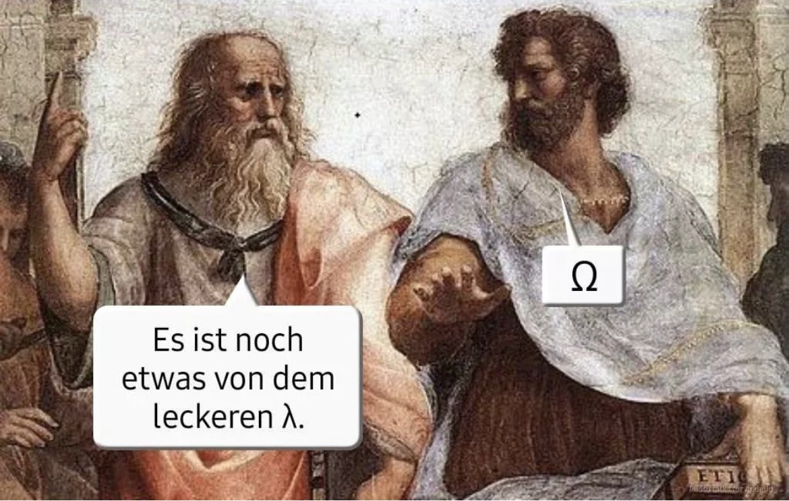

## Organisation {background-image="../assets/degas_la-repetition-de-chant_1877.png" background-opacity="0.4"}

#### Learning Management System / Protokolle

 

. . . 

→ [Kurs im LMS der HMTMH](https://lms.hmtm-hannover.de/course/view.php?id=437)

 

. . .

→ **Protokolle** bitte immer bis **Mo, 18 Uhr** senden an: 

[julian.popken@hmtm-hannover.de](mailto:Julian.Popken@hmtm-hannover.de) 

und 

[stachurad@stud.hmtm-hannover.de](mailto:stachurad@stud.hmtm-hannover.de)

#### {background-iframe="https://bdg-online.org/" background-interactive=true}

## Geschichte der Gesangspädagogik I - Antike {background-image="../assets/degas_la-repetition-de-chant_1877.png" background-opacity="0.4"}

### Westeuropäische Musik:   Welche Quellen gibt es?

#### Wiederholung: Geschichte der ganzen Welt (Selbststudium)

. . .

<iframe width="1120" height="500" src="https://www.youtube.com/embed/xuCn8ux2gbs?si=wE6_uLhOtgO0Y1Tz" title="YouTube video player" frameborder="0" allow="accelerometer; autoplay; clipboard-write; encrypted-media; gyroscope; picture-in-picture; web-share" referrerpolicy="strict-origin-when-cross-origin" allowfullscreen></iframe>

:::{style="font-size: 20px; margin-top: -30px"}
Bill Wurtz: *history of the entire world, i guess* ([Youtube 2017](https://www.youtube.com/watch?v=xuCn8ux2gbs))
:::

#### Antiker Naher Osten

{width="80%"}

:::{style="font-size: 20px; margin-top: -30px"}
[@grout2019, 6]
:::

:::{.notes}
- Westeuropäische Kultur der Amerikas und Europas in Abgrenzung zu (fern)-östlichen Kulturen. 
- Wichtigste Regionen für unsere Mathematik, Kalender, Astronomie, Medizin: Mesopotamien, Ägypten und vor allem: Antikes Griechenland, Römisches Reich
:::

#### Griechische Siedlungen (ca. 550 v. u. Z.)

{width="80%"}

:::{style="font-size: 20px; margin-top: -30px"}
[@grout2019, 8]
:::

:::{.notes}
- Unsere Philosophie: Platon und Aristoteles
- Wichtig: Quasi Zufall, könnten je nach Entwicklung auch andere Zivilisationen stärker gewesen sein.
- Griechische Schriften stärkste Quelle für heutiges Musikverständnis.
- Musik ist Kunst in der Zeit und daher nicht permanent. 
- Spuren also:
:::

### Materielle/physische Überreste

- Musikinstrumente, Aufführungsorte

. . .

<iframe src="https://www.google.com/maps/embed?pb=!1m14!1m12!1m3!1d155522.7769690091!2d9.766364198705007!3d48.380101280739225!2m3!1f0!2f0!3f0!3m2!1i1024!2i768!4f13.1!5e0!3m2!1sde!2sde!4v1789310076742!5m2!1sde!2sde" width="100%" height="500" style="border:0;" allowfullscreen="" loading="lazy" referrerpolicy="strict-origin-when-cross-origin" class="r-stretch"></iframe>

#### Hohle Fels Schelklingen (ca. 40.000 v. u. Z.)

::::{.columns}

:::{.column width="50%" .fragment}
{width="70%"}

:::{style="font-size: 20px; margin-top: -30px"}
[Wikimedia](https://upload.wikimedia.org/wikipedia/commons/a/a3/Hohler_Fels.jpg?utm_source=de.wikipedia.org&utm_campaign=imageinfo&utm_content=original)
:::

:::

:::{.column width="50%" .fragment}
{width="35%"}

:::{style="font-size: 20px; margin-top: -30px"}
[@grout2019, 5]
:::
:::

::::

:::{.notes}
Die Karsthöhle Hohler Fels liegt etwa einen Kilometer östlich des Stadtkerns von Schelklingen im baden-württembergischen Alb-Donau-Kreis in Deutschland. Sie ist seit dem 19. Jahrhundert einer der bedeutendsten archäologischen Fundplätze des Jungpaläolithikums in Mitteleuropa.

Front view of a bone flute made from the radius (wing bone) of a griffon vulture, unearthed in 2008 at Hohle Fels Cave in the Ach Valley in Swabia (southwestern Germany) and estimated to date from about 40,000 to 42,000 years ago. With five finger holes, it is the most complete of the early flutes yet recovered.
:::

#### Nachbau sumerische Stierleier (ca. 2500 v. u. Z.)

{.r-stretch}

:::{style="font-size: 20px; margin-top: -30px"}
[@grout2019, 7]
:::

#### Klangliche Annäherung



:::{style="font-size: 20px; margin-top: -60px"}
[@peterpringle2022]
:::

:::{.notes}
This video is a performance of a Sumerian incantation and lament upon the death of the hero, GILGAMESH. For those who are interested, the translation and transliteration of the Sumerian cuneiform tablets can be found online at the University of Oxford website - The Electronic Text Corpus Of Sumerian Literature.

“The Gold Lyre of Ur” was unearthed by archaeologist, Sir Leonard Woolley, in the 1920’s during his excavations in the Sumerian city of Ur, in modern day Iraq. Unfortunately, as you can see from the photo at the top of the video, there was little left of the lyre because the Sumerians simply put it into the ground 5000 years ago and covered it over with tons of earth. In the intervening millennia, everything that was degradable turned to dust, and only the imprint of the instrument was left, along with the stone mosaic decorations, the four vignettes made of shell, and the gold. 

Thanks to very careful measurements and photos taken by Woolley, museum curators have been able to reconstruct the fragile bits and pieces, and the instrument is now on display in Baghdad. What you see in this video is my own replica, made from cedar like the original. Needless to say, I used brass sheeting instead of gold, but it is unlikely that the ornamentation would change the basic sound of the instrument. 

A lyre of this size, whose lowest note is the same as the lowest ‘C’ on a piano keyboard, would probably have been used as a drone instrument, and would not have been used to play melodies like a harp or a smaller lyre. The bench-shaped bridges used on these instruments, suggest that they probably “buzzed” like the modern Indian tamboura, or the Ethiopian “begena” lyre. The buzzing sound made possible by the wide flat bridge, greatly increases the volume output of the string, as well as the decay time of the vibration.

The large “balag” drum you see on my left in the video, is four feet (120 cm) in diameter, and was a common percussion instrument in Sumer, although there are none that have survived the ages. These drums were an integral part of ceremonies to summon the souls in the “Netherworld” because, as you can hear, they make enough noise “to wake the dead”! The belief in an afterlife was an integral part of Sumerian culture, and I highly recommend Dr. Irving Finkel’s wonderful book on the subject, THE FIRST GHOSTS.

The video of my full performance was too long, so I have edited it down to about 8 minutes (still too long IMO). Much of this sort of incantation was repetition, but I suspect the ancient Sumerians had a greater tolerance for long, drawn-out rituals than most of us do today. I chopped several minutes out of the middle. 

We have the Sumerian cuneiform texts, as well as some of the musical instruments, but we do not have the melodies because the Sumerians didn’t write them down. I believe that the parts that were sung were probably largely improvised, just as they are today in the Middle East and the Indian subcontinent. Ancient Sumerian teachers did not write down their music because they taught mainly by memory and by ear.

From the standpoint of a singer, I have performed these texts in a loud, declarative style. The Sumerians did not have amplification, and singers had to be heard by large crowds at temple gatherings, or sometimes outside.
:::

### Bildliche Darstellungen

- Darstellungen von MusikerInnen, Instrumenten, Aufführungen

. . .

{width="60%"}

:::{style="font-size: 20px; margin-top: -30px"}
[@grout2019, 7]
:::

### Schriftwerke über Musik und MusikerInnen

- Beispiel: Enheduanna (ca. 2300 v. Chr.)

. . .

{width="60%"}

:::{style="font-size: 20px; margin-top: -30px"}
[@grout2019, 10]
:::

:::{.notes}
Enheduanna (ca. 2300 v. Chr.): Sie war eine mesopotamische Prinzessin und Hohepriesterin des Mondgottes Nanna im sumerischen Ur. Sie verfasste religiöse Hymnen, die sie mit ihrem Namen versah, und gilt damit als älteste namentlich überlieferte Dichterin und Liedschöpferin der Welt.
:::
  

:::{.notes}
- Unsere Philosophie: Platon und Aristoteles
- Wichtig: Quasi Zufall, könnten je nach Entwicklung auch andere Zivilisationen stärker gewesen sein.
- Griechische Schriften stärkste Quelle für heutiges Musikverständnis.
- Musik ist Kunst in der Zeit und daher nicht permanent. 
- Spuren also:
:::

### Materielle/physische Überreste

- Musikinstrumente, Aufführungsorte

### Musik selbst

- Notation, Mündliche Tradition, Tonaufnahmen (seit ca. 1870)

#### Früheste Notation eines kompletten Werkes   (ca. 1400-1250 v. u. Z.) 

{width="80%"}

:::{style="font-size: 20px; margin-top: -30px"}
[@grout2019, 8]
:::

:::{.notes}
The oldest nearly complete piece, from ca. 1400-1250 BCE, is on a tablet shown in Figure 1.5 that was found at Ugarit, a merchant city-state on the Syrian coast. Scholars have proposed possible transcriptions for the music, but the notation is too poorly understood to be read with confidence. Despite the invention of notation, most music was either played from memory or improvised. Musicians most likely did not play or sing from notation, as modern performers do, but used it as a written record from which a melody could be reconstructed, as cooks use a recipe.
:::

#### Früheste Aufnahmen

 

. . .

**1860**: Edouard-Leon Scott de Martinville (Phonautograph)

"Au clair de la lune"

<section>
  <audio controls>
    <source src="https://www.firstsounds.org/sounds/Scott-Feaster-No-36.mp3" type="audio/mpeg">
    Ihr Browser unterstützt kein Audio-Element.
  </audio>
</section>

**1878**: Thomas Edison (Phonograph)

"Mary had a little lamb"

<section>
  <audio controls>
    <source src="https://upload.wikimedia.org/wikipedia/commons/6/63/Thomas_Edison_Mary_had_lamb.ogg?utm_source=commons.wikimedia.org&utm_campaign=index&utm_content=original" type="audio/mpeg">
    Ihr Browser unterstützt kein Audio-Element.
  </audio>
</section>

## Akustik I

#### Grundbegriffe

Akustik
: Lehre vom Schall und seiner Ausbreitung

 

Schall
: Mechanische Schwingung in einem elastischen Medium (Gas, Flüssigkeit, Festkörper)
: Breitet sich _radial_ von einer Schallquelle aus
: Ausbreitung in Schallwellen: Molekülabstand nimmt periodisch ab und zu

####

{width="80%"}

Quelle: Meyer, Jürgen: <em>Akustik und musikalische Aufführungspraxis.</em> Frankfurt. 4. Auflage, 2004.

#### Warum würden wir im All niemanden singen hören?

#### Das menschliche Ohr^[https://img.poweredcache.net/das-hoerhaus.de/wp-content/uploads/2016/05/Wie_f_DasOhr.jpg?rs=fill&w=585&h=600&ssl=1]

:::{.notes}
Die Ohrmuschel sammelt das Signal (Geräusche, Stimmen) und bringt es über den Gehörgang, den Du dir als Tunnel vorstellen kannst, zum Trommelfell. Das Trommelfell bewegt sich wenn das Signal darauf trifft vor und zurück. Es ist ein Häutchen das den Gehörgang verschließt.

Hinter dem Trommelfell liegen drei winzige Gehörknöchelchen: Hammer, Amboss und Steigbügel. Diese sind wie eine Kette verbunden. Die Gehörknöchelchen machen das Signal lauter und geben es ans Innenohr weiter.

Das Innenohr kannst Du dir als Schnecke (Fachbegriff: Cochlear) vorstellen die mit Flüssigkeit gefüllt ist. In dieser Schnecke sind überall kleine Härchen. Wenn das Signal auf die Härchen (Haarsinneszellen) trifft bewegen Sie sich. Dadurch wird das Signal über den Hörnerv an dein Gehirn weitergeleitet und dort verarbeitet, dass heißt: Du hörst etwas.

Wenn die Härchen abgebrochen sind oder fehlen, hörst Du nicht mehr gut.

Außerdem ist an Dein Innenohr das Gleichgewichtsorgan angebunden, das sorgt dafür das Du dein Gleichgewicht halten kannst. Wenn du es durcheinander bringst wird Dir schwindlig z. B. wenn du dich lange auf dem Karussel drehst.
:::

### Wellenformen^[Grafiken Wellenformen: „Wellentypen - Transversalwelle (Animation) | LEIFIphysik“. Zugegriffen 20. Oktober 2025. https://www.leifiphysik.de/mechanik/mechanische-wellen/downloads/wellentypen-transversalwelle-animation.]

. . .

**Transversalwelle** (Seil, Geigensaite)

::::{.columns}

:::{.column width="60%"}
- Teilchen werden im rechten Winkel zur Ausbreitungsrichtung ausgelenkt.
:::

:::{.column width="40%" .fragment}
{width="50%"}
:::

::::

- Die einzelnen Teilchen bewegen sich an feststehendem Ort auf und ab.

- Nur das Wellenmuster bewegt sich weiter.

#### Longitudinalwelle (Schall)

::::{.columns}

:::{.column width="60%"}
- Teilchen werden parallel zur Ausbreitungsrichtung ausgelenkt.
:::

:::{.column width="40%" .fragment}
{width="50%"}
:::

::::

- Die einzelnen Teilchen bewegen sich in/gegen die Ausbreitungsrichtung vor bzw. zurück.

- Die Ausbreitung des Schalls erfolgt _radial_ von der Schallquelle. (Nicht wie in der Grafik).

#### Kombination Longitudinal- + Transversalwelle (Wasser)

::::{.columns}

:::{.column width="60%"}
- Teilchen auf Wasseroberfläche bewegen sich sowohl vor und zurück als auch hoch und runter.
:::

:::{.column width="40%" .fragment}
{width="50%"}
:::

::::

- Die einzelnen Teilchen beschreiben in vollständiger Bewegung eine kreisförmige Linie. 

- Eine Ente auf der Wasseroberfläche bliebe ungefähr am gleichen Ort.

#### 

Quelle: Hall, Donald E.: <em>Musikalische Akustik. Ein Handbuch.</em> Main, 1997.

#### Amplitude

- Maß der Auslenkung = Schalldruck
- Angegeben in Dezibel (**dB**) = Logarithmischer Maßstab

 

- Orchesterfortissimo: 90 - 100 dB
- Orchesterpianissimo: 40 - 45 dB
- OpernsängerIn: bis 105 dB (Formanten)

:::{.notes}
Logarithmischer Maßstab (Logarithmus: die Zahl mit der man eine Basiszahl potenzieren
muss, um die vorgegebene Zahl Numerus zu erhalten).
:::

#### Wellenlänge (**λ**)

- Abstand zwischen zwei Wellenhügeln (Druck- oder Verdichtungsmaxima).
- Je größer die Wellenlänge, desto tiefer der Ton.

. . .

$$
Wellenlänge = \frac{Schallgeschwindigkeit}{Frequenz}
$$

. . .

$$
λ = \frac{c}{f}
$$

#### Frequenz (**f**)

- Anzahl der Druckschwankungen bzw. Schwingungen pro Sekunde.
- Gemessen in **Hertz** (=Hz).
- Abhängig von Wellenlänge **λ** und Schallgeschwindigkeit **c** 
- Berechnung bei trockener Luft, 20°C:

. . .

$$
f = \frac{c}{λ}
$$

#### Frequenzbeispiele

#### Ausnutzung von Hörgrenzen

<iframe data-preload class="r-stretch" src="../assets/Mosquito Flyer (D) Stand 3 2025 DIGI.pdf"></iframe>

Quelle: [Antivandalismus.de](https://www.antivandalismus.de/)

#### Schallgeschwindigkeit (**c**)

- Fortpflanzungsgeschwindigkeit, mit der sich Druckschwankungen über den Luftraum ausbreiten.
- In der Luft u. a. abhängig von der Temperatur, **c** nimmt bei ansteigender Temperatur zu. (Beispiel Freiluftaufführungen, etwa über einem Gewässer.)

#### Schallgeschwindigkeit in verschiedenen Medien

{width="35%"}

#### Fragen?

{.r-stretch}

#### Quellen/Medien
