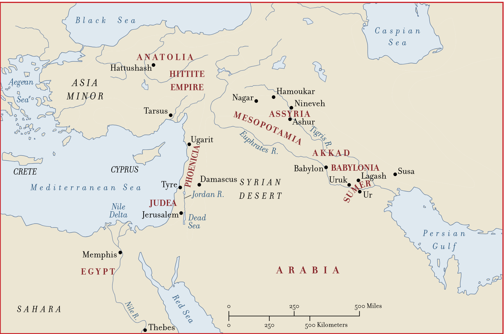
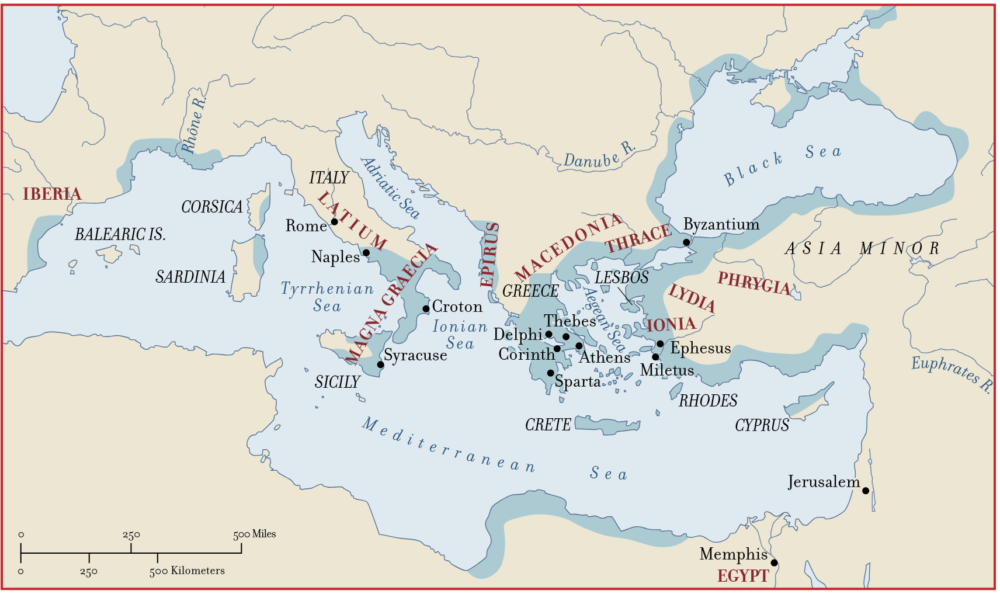
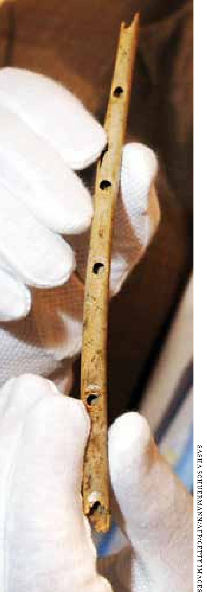
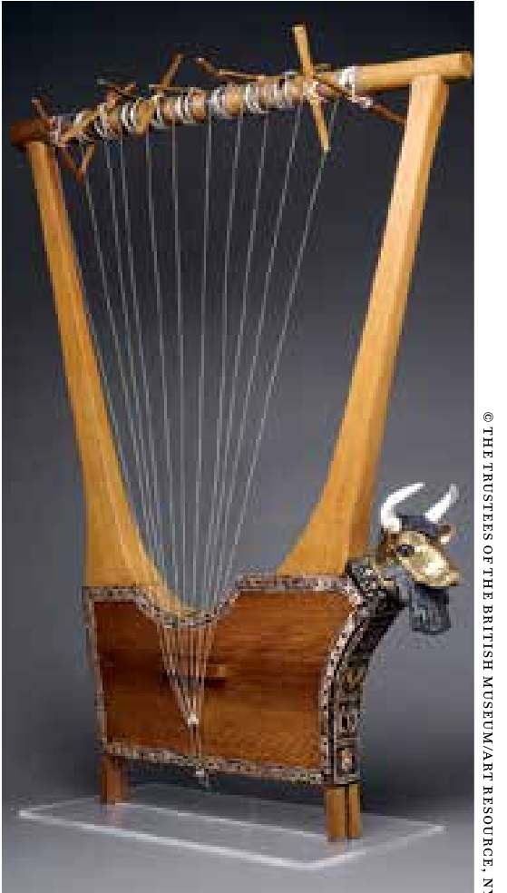
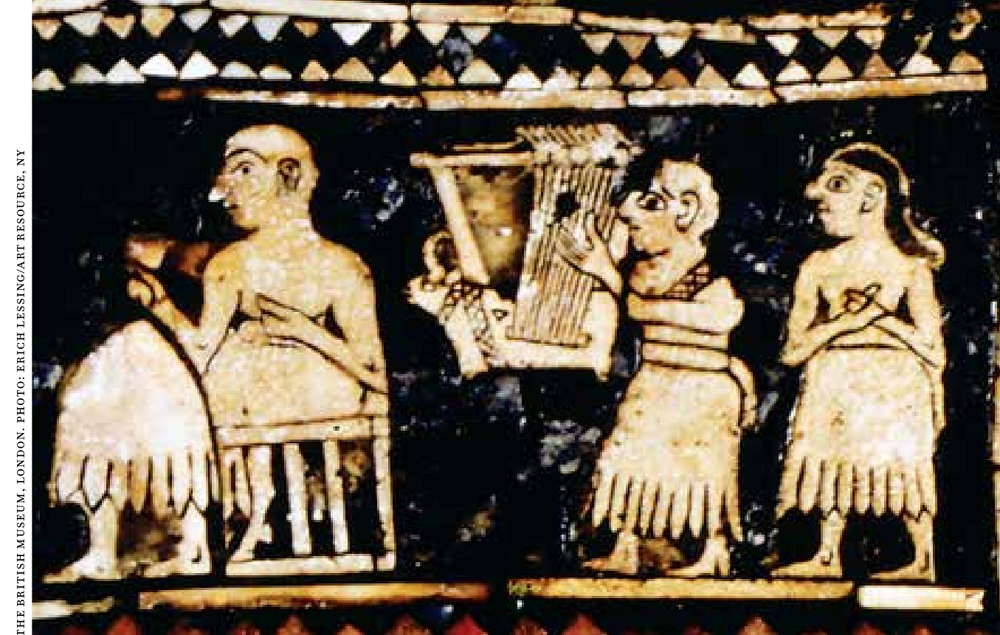
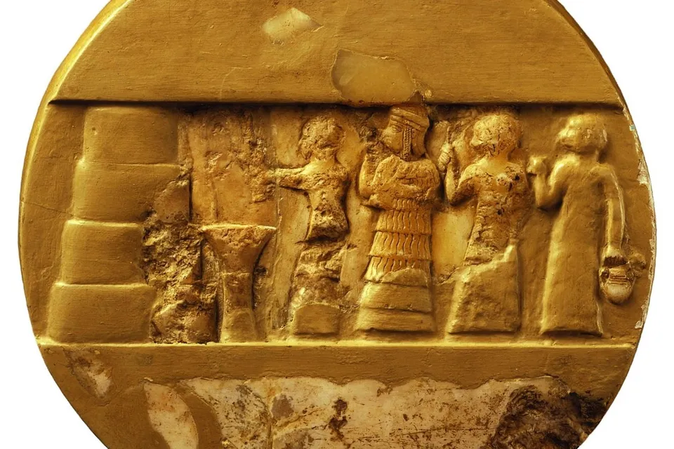
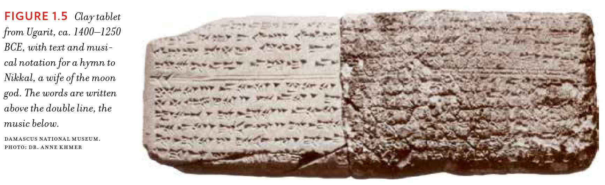

## Organisation {background-image="../assets/degas_la-repetition-de-chant_1877.png" background-opacity="0.4"}

#### Learning Management System / Protokolle

 

. . . 

→ [Kurs im LMS der HMTMH](https://lms.hmtm-hannover.de/course/view.php?id=437)

 

. . .

→ **Protokolle** bitte immer bis **Mo, 18 Uhr** senden an: 

[julian.popken@hmtm-hannover.de](mailto:Julian.Popken@hmtm-hannover.de) 

und 

[stachurad@stud.hmtm-hannover.de](mailto:stachurad@stud.hmtm-hannover.de)

#### {background-iframe="https://bdg-online.org/" background-interactive=true}

## Geschichte der Gesangspädagogik I - Antike {background-image="../assets/degas_la-repetition-de-chant_1877.png" background-opacity="0.4"}

### Historische Quellen Westeuropäischer Musik

#### Antiker Naher Osten

:::{style="font-size: 20px; margin-top: -30px"}
[@grout2019, 6]
:::

:::{.notes}
- Westeuropäische Kultur der Amerikas und Europas in Abgrenzung zu (fern)-östlichen Kulturen. 
- Wichtigste Regionen für unsere Mathematik, Kalender, Astronomie, Medizin: Mesopotamien, Ägypten und vor allem: Antikes Griechenland, Römisches Reich
:::

#### Griechische Siedlungen ca. 550 v. u. Z.

:::{style="font-size: 20px; margin-top: -30px"}
[@grout2019, 8]
:::

:::{.notes}
- Unsere Philosophie: Platon und Aristoteles
- Wichtig: Quasi Zufall, könnten je nach Entwicklung auch andere Zivilisationen stärker gewesen sein.
- Griechische Schriften stärkste Quelle für heutiges Musikverständnis.
- Musik ist Kunst in der Zeit und daher nicht permanent. 
- Spuren also:
:::

### Materielle/physische Überreste

- Musikinstrumente, Aufführungsorte

. . .

<iframe src="https://www.google.com/maps/embed?pb=!1m14!1m12!1m3!1d155522.7769690091!2d9.766364198705007!3d48.380101280739225!2m3!1f0!2f0!3f0!3m2!1i1024!2i768!4f13.1!5e0!3m2!1sde!2sde!4v1789310076742!5m2!1sde!2sde" width="100%" height="500" style="border:0;" allowfullscreen="" loading="lazy" referrerpolicy="strict-origin-when-cross-origin" class="r-stretch"></iframe>

#### 

####

#### Klangliche Annäherung



:::{style="font-size: 20px; margin-top: -60px"}
[@peterpringle2022]
:::

:::{.notes}
This video is a performance of a Sumerian incantation and lament upon the death of the hero, GILGAMESH. For those who are interested, the translation and transliteration of the Sumerian cuneiform tablets can be found online at the University of Oxford website - The Electronic Text Corpus Of Sumerian Literature.

“The Gold Lyre of Ur” was unearthed by archaeologist, Sir Leonard Woolley, in the 1920’s during his excavations in the Sumerian city of Ur, in modern day Iraq. Unfortunately, as you can see from the photo at the top of the video, there was little left of the lyre because the Sumerians simply put it into the ground 5000 years ago and covered it over with tons of earth. In the intervening millennia, everything that was degradable turned to dust, and only the imprint of the instrument was left, along with the stone mosaic decorations, the four vignettes made of shell, and the gold. 

Thanks to very careful measurements and photos taken by Woolley, museum curators have been able to reconstruct the fragile bits and pieces, and the instrument is now on display in Baghdad. What you see in this video is my own replica, made from cedar like the original. Needless to say, I used brass sheeting instead of gold, but it is unlikely that the ornamentation would change the basic sound of the instrument. 

A lyre of this size, whose lowest note is the same as the lowest ‘C’ on a piano keyboard, would probably have been used as a drone instrument, and would not have been used to play melodies like a harp or a smaller lyre. The bench-shaped bridges used on these instruments, suggest that they probably “buzzed” like the modern Indian tamboura, or the Ethiopian “begena” lyre. The buzzing sound made possible by the wide flat bridge, greatly increases the volume output of the string, as well as the decay time of the vibration.

The large “balag” drum you see on my left in the video, is four feet (120 cm) in diameter, and was a common percussion instrument in Sumer, although there are none that have survived the ages. These drums were an integral part of ceremonies to summon the souls in the “Netherworld” because, as you can hear, they make enough noise “to wake the dead”! The belief in an afterlife was an integral part of Sumerian culture, and I highly recommend Dr. Irving Finkel’s wonderful book on the subject, THE FIRST GHOSTS.

The video of my full performance was too long, so I have edited it down to about 8 minutes (still too long IMO). Much of this sort of incantation was repetition, but I suspect the ancient Sumerians had a greater tolerance for long, drawn-out rituals than most of us do today. I chopped several minutes out of the middle. 

We have the Sumerian cuneiform texts, as well as some of the musical instruments, but we do not have the melodies because the Sumerians didn’t write them down. I believe that the parts that were sung were probably largely improvised, just as they are today in the Middle East and the Indian subcontinent. Ancient Sumerian teachers did not write down their music because they taught mainly by memory and by ear.

From the standpoint of a singer, I have performed these texts in a loud, declarative style. The Sumerians did not have amplification, and singers had to be heard by large crowds at temple gatherings, or sometimes outside.
:::

### Bildliche Darstellungen

- Darstellungen von MusikerInnen, Instrumenten, Aufführungen

. . .

### Schriftwerke über Musik und MusikerInnen

#### Beispiel: Enheduanna (ca. 2300 v. Chr.)

:::{.notes}
Enheduanna (ca. 2300 v. Chr.): Sie war eine mesopotamische Prinzessin und Hohepriesterin des Mondgottes Nanna im sumerischen Ur. Sie verfasste religiöse Hymnen, die sie mit ihrem Namen versah, und gilt damit als älteste namentlich überlieferte Dichterin und Liedschöpferin der Welt.
:::
  

### Musik selbst

- Notation, Mündliche Tradition, Tonaufnahmen (seit ca. 1870)

#### Früheste Notation eines kompletten Werkes   (ca. 1400-1250 v. Chr.) 

:::{.notes}
The oldest nearly complete piece, from ca. 1400-1250 BCE, is on a tablet shown in Figure 1.5 that was found at Ugarit, a merchant city-state on the Syrian coast. Scholars have proposed possible transcriptions for the music, but the notation is too poorly understood to be read with confidence. Despite the invention of notation, most music was either played from memory or improvised. Musicians most likely did not play or sing from notation, as modern performers do, but used it as a written record from which a melody could be reconstructed, as cooks use a recipe.
:::
