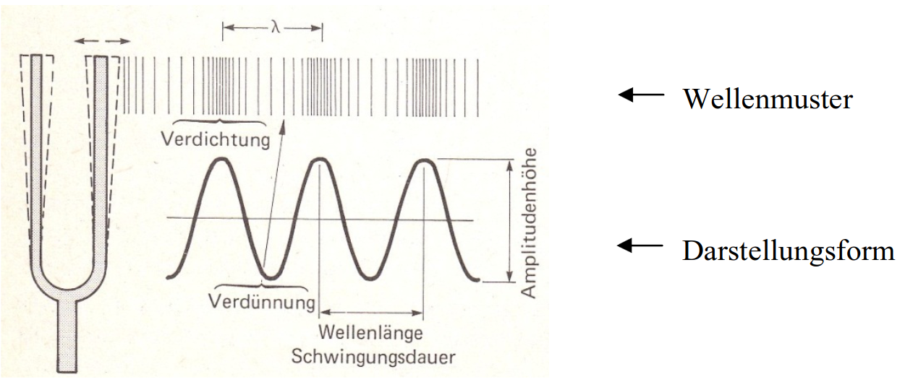
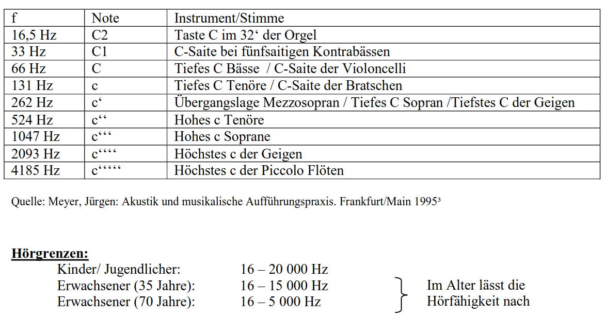
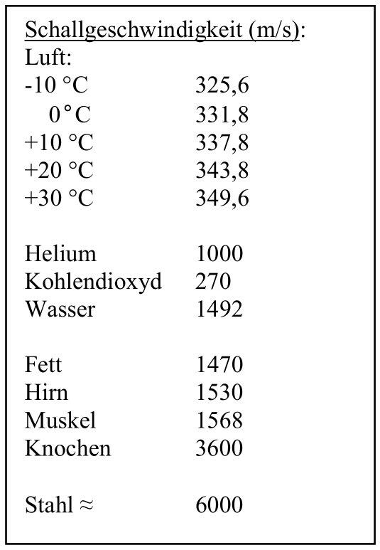
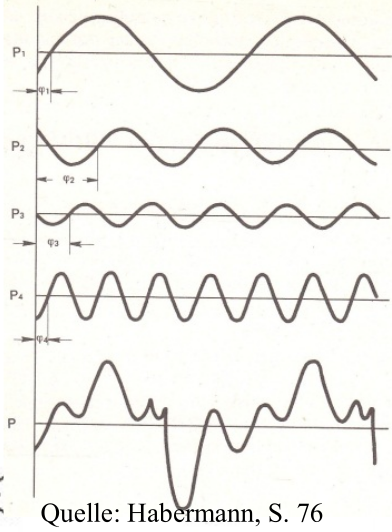

## Wiederholung {background-image="../assets/degas_la-repetition-de-chant_1877.png" background-opacity="0.4"}

### Geschichte II - Antike {background-image="../assets/degas_la-repetition-de-chant_1877.png" background-opacity="0.4"}

#### Griechische Tragödie

{.r-stretch}

:::{style="font-size: 20px; margin-top: -30px"}
Theater von Epidauros, ca. 400 v. u. Z., Platz für 14.000 Zuschauer
:::

:::{.notes}
- Ursprünglich Feiern zu Ehren des Gottes Dionysos (Wein)
- Dionysoskult zum Staatskult erhoben - Große Dionysien als jährliches großes Fest
- Gesungen, getanzt, Böcke geopfert - Tragos (Bock, Ziegenbock) und ode (Gesang) "Bocksgesang"
- 534 v. Chr. erste Tragödie v. Thespis(singendem und tanzenden Chor wird ein Schauspieler gegenübergestellt)
- später 2 Aischylos, dann 3 Sophokles
- Chor spielt zentrale Rolle: Kommentierend, singend, tanzend in verschiedenen Formationen
Im klassischen griechischen Theater (wie im berühmten Theater von Epidaurus) war der Chor das Herzstück. Die Sänger standen in der kreisförmigen Orchestra (dem Tanzplatz) und kommentierten singend und tanzend das Geschehen auf der Bühne.

- Die Orchestra: ursprünglich Raum zum Tanzen/Singen um Altar von Dionysos, später Auftrittsraum für Chor und Schauspieler
:::

#### 

::::{.columns}

:::{.column width="50%" .fragment}

:::

:::{.column width="50%" .fragment .absolute top=150 right=20}

:::

::::

:::{style="font-size: 20px; margin-top: -30px"}
Nachbildungen griechischer Tragödienmasken
:::

:::{.notes}
- Schauspieler (alles Männer) trugen Masken. Alles Nachbildungen von Vasen, Amphoren

-   Die Maske gab ein starres, erschreckendes Aussehen.
Die Individualität und Identität des Schauspielers wurde abgelegt.
Sie vereinfachte dem Schauspieler das Rollenspiel.
Eventuell zur akustischen Projektion.

- Wie vorstellen? Wettbewerb dreier Tragödien hintereinander = mehrere Stunden. Leute aßen, sprachen, tranken währenddessen.

:::

#### Musikverständnis griech. Antike bis 5. Jhd. v. u. Z.

- Musik als untrennbare Einheit von Wort, Ton und Tanz. Lehre als Ethos.
- Ab ca. 5. Jhd. v. u. Z.: Professionalisierung und erste "Gesangsschulen". (Etwa d. "**Dionysische Verein**")
- Steigende technische Anforderungen an die Stimme: Projektion, Textverständlichkeit

:::{.notes}

1
- Philosophen wie Platon und Aristoteles ordneten der Musik eine direkte Wirkung auf das Gemüt und den Charakter zu (Ethos-Lehre). Richtiges Singen sollte Tugend, Disziplin und innere Harmonie fördern.
• Der „musikalische Mensch“: Wer nicht singen und kein Saiteninstrument (wie die Lyra) spielen konnte, galt als ungebildet.
• Methodik: Der Unterricht erfolgte rein mündlich und empirisch durch Nachahmung und ständige Wiederholung (Mimesis).

2
• *Die dionysischen Gilden:* Da die Laienchöre diesen Ansprüchen nicht mehr genügten, gründeten sich professionelle Vereinigungen. Um 500 v. Chr. entstand in Athen der Dionysische Verein. Diese Gilde bildete Schauspieler, Sänger und Musiker gezielt aus und gilt in der Forschung als die erste institutionalisierte Form einer Gesangspädagogik laut Wikipedia.

Die dionysischen Vereine (historisch vor allem als dionysische Techniten bekannt) waren im antiken Griechenland und im Hellenismus berufsständische Vereinigungen von Künstlern und Mitwirkenden des Theaters und Kults.  
:::

#### Akustik: Theater von Epidauros

<iframe width="100%" height="80%" src="https://www.youtube.com/embed/g7sYicYfPrs?si=z41-ImUMIwT-74yz&amp;start=47" title="YouTube video player" frameborder="0" allow="accelerometer; autoplay; clipboard-write; encrypted-media; gyroscope; picture-in-picture; web-share" referrerpolicy="strict-origin-when-cross-origin" allowfullscreen></iframe>

:::{style="font-size: 20px; margin-top: -30px"}
[Youtube: Rick Steve's Europe]
:::

:::{.notes}
- Kalksteine als Hochpassfilter
:::

#### Phonasken

- Einzahl: Phonaske, von griechisch "phonaskéō = die Stimme üben"
- Stimmlehrer und Rhetoriktrainer der griechisch-römischen Antike
- Allgemeinbildung (!) durch regelmäßige Atem-, Deklamations- und Gesangsübungen

:::{.notes}
Kontrolle beim Auftritt: Historischen Berichten zufolge ließen sich prominente Redner oder Schauspieler oft von einem Phonasken zu ihren Auftritten begleiten, um die Kehle zu schonen und die Tonhöhe zu kontrollieren. Vom römischen Politiker Gaius Gracchus ist beispielsweise bekannt, dass hinter ihm ein Sklave stand, der ihm mit einer Flöte oder Pfeife das richtige Register anzeigte.

- Steinplatte auf Brust

- 
:::

### Akustik II {background-color="#0FA3B1"}

#### 

Quelle: Hall, Donald E.: <em>Musikalische Akustik. Ein Handbuch.</em> Main, 1997.

#### Amplitude

- Maß der Auslenkung = Schalldruck
- Angegeben in Dezibel (**dB**) = Logarithmischer Maßstab

 

- Orchesterfortissimo: 90 - 100 dB
- Orchesterpianissimo: 40 - 45 dB
- OpernsängerIn: bis 105 dB (Formanten)

:::{.notes}
Logarithmischer Maßstab (Logarithmus: die Zahl mit der man eine Basiszahl potenzieren
muss, um die vorgegebene Zahl Numerus zu erhalten).
:::

#### Wellenlänge (**λ**)

- Abstand zwischen zwei Wellenhügeln (Druck- oder Verdichtungsmaxima).
- Je größer die Wellenlänge, desto tiefer der Ton.

. . .

$$
Wellenlänge = \frac{Schallgeschwindigkeit}{Frequenz}
$$

. . .

$$
λ = \frac{c}{f}
$$

#### Frequenz (**f**)

- Anzahl der Druckschwankungen bzw. Schwingungen pro Sekunde.
- Gemessen in **Hertz** (=Hz).
- Abhängig von Wellenlänge **λ** und Schallgeschwindigkeit **c** 
- Berechnung bei trockener Luft, 20°C:

. . .

$$
f = \frac{c}{λ}
$$

#### Frequenzbeispiele

#### Ausnutzung von Hörgrenzen

<iframe data-preload class="r-stretch" src="../assets/Mosquito Flyer (D) Stand 3 2025 DIGI.pdf"></iframe>

Quelle: [Antivandalismus.de](https://www.antivandalismus.de/)

#### Schallgeschwindigkeit (**c**)

- Fortpflanzungsgeschwindigkeit, mit der sich Druckschwankungen über den Luftraum ausbreiten.
- In der Luft u. a. abhängig von der Temperatur, **c** nimmt bei ansteigender Temperatur zu. (Beispiel Freiluftaufführungen, etwa über einem Gewässer.)

#### Schallgeschwindigkeit in verschiedenen Medien

{width="35%"}

#### Kammerton {.smaller} 

. . .

a' = **440 Hz** 

- Festgelegt 1939 auf der Internationalen Stimmtonkonferenz in London. 
- Früher Abgrenzung Kammerton zu Chor-/Orgelton. 
- Orchesterstimmton 443 Hz (Deutschland/Österreich), 442 Hz (Schweiz/Italien )
- Übliche, historisch orientierte Stimmtöne: 
    - 415 Hz (Barock) 
    - 430 Hz (Klassik) 
    - 438 Hz (Romantik)

- Tendenz geht in Richtung zunehmend höherer Stimmtöne (Brillanz Streicher u. a.)
- Zu schnelle Entwicklung für die menschliche Stimme. 
- Fortwährende Evolution Richtung tiefere Stimme?

#### Überlagerung von (Schall-)Wellen (Interferenz)

- **Achtung**: Grafische Darstellung von Longitudinalwellen (Schall) in der Regel als Transversalwelle!

- Verschiedene Schallwellen stören sich nicht, sondern addieren sich zu einer neuen Schallwelle.

#### Überlagerung von Teiltönen zu einem Klang

{.r-stretch .lightbox}

## Geschichte III - Mittelalter {background-image="../assets/degas_la-repetition-de-chant_1877.png" background-opacity="0.4"}

#### Quellen/Medien
