## Wiederholung

### Akustik I {background-color="#0FA3B1"}

#### Grundbegriffe

Akustik
: Lehre vom Schall und seiner Ausbreitung

 

Schall
: Mechanische Schwingung in einem elastischen Medium (Gas, Flüssigkeit, Festkörper)
: Breitet sich _radial_ von einer Schallquelle aus
: Ausbreitung in Schallwellen: Molekülabstand nimmt periodisch ab und zu

####

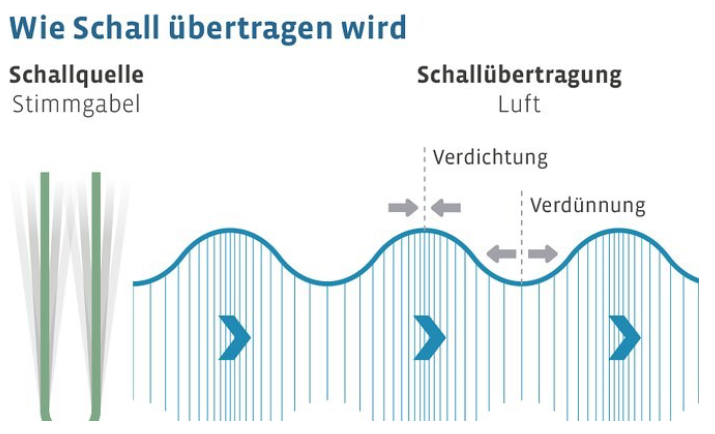{width="80%"}

Quelle: Meyer, Jürgen: <em>Akustik und musikalische Aufführungspraxis.</em> Frankfurt. 4. Auflage, 2004.

#### Warum würden wir im All niemanden singen hören?

#### Das menschliche Ohr^[https://www.rottler.de/hs-fs/hubfs/Website/Blog/Blog_Aufbau_Ohr_1080x500.png?width=1080&height=500&name=Blog_Aufbau_Ohr_1080x500.png]

:::{.notes}
Die Ohrmuschel sammelt das Signal (Geräusche, Stimmen) und bringt es über den Gehörgang, den Du dir als Tunnel vorstellen kannst, zum Trommelfell. Das Trommelfell bewegt sich wenn das Signal darauf trifft vor und zurück. Es ist ein Häutchen das den Gehörgang verschließt.

Hinter dem Trommelfell liegen drei winzige Gehörknöchelchen: Hammer, Amboss und Steigbügel. Diese sind wie eine Kette verbunden. Die Gehörknöchelchen machen das Signal lauter und geben es ans Innenohr weiter.

Das Innenohr kannst Du dir als Schnecke (Fachbegriff: Cochlear) vorstellen die mit Flüssigkeit gefüllt ist. In dieser Schnecke sind überall kleine Härchen. Wenn das Signal auf die Härchen (Haarsinneszellen) trifft bewegen Sie sich. Dadurch wird das Signal über den Hörnerv an dein Gehirn weitergeleitet und dort verarbeitet, dass heißt: Du hörst etwas.

Wenn die Härchen abgebrochen sind oder fehlen, hörst Du nicht mehr gut.

Außerdem ist an Dein Innenohr das Gleichgewichtsorgan angebunden, das sorgt dafür das Du dein Gleichgewicht halten kannst. Wenn du es durcheinander bringst wird Dir schwindlig z. B. wenn du dich lange auf dem Karussel drehst.
:::

### Wellenformen^[Grafiken Wellenformen: „Wellentypen - Transversalwelle (Animation) | LEIFIphysik“. Zugegriffen 20. Oktober 2025. https://www.leifiphysik.de/mechanik/mechanische-wellen/downloads/wellentypen-transversalwelle-animation.]

. . .

**Transversalwelle** (Seil, Geigensaite)

::::{.columns}

:::{.column width="60%"}
- Teilchen werden im rechten Winkel zur Ausbreitungsrichtung ausgelenkt.
:::

:::{.column width="40%" .fragment}
{width="50%"}
:::

::::

- Die einzelnen Teilchen bewegen sich an feststehendem Ort auf und ab.

- Nur das Wellenmuster bewegt sich weiter.

#### Longitudinalwelle (Schall)

::::{.columns}

:::{.column width="60%"}
- Teilchen werden parallel zur Ausbreitungsrichtung ausgelenkt.
:::

:::{.column width="40%" .fragment}
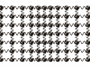{width="50%"}
:::

::::

- Die einzelnen Teilchen bewegen sich in/gegen die Ausbreitungsrichtung vor bzw. zurück.

- Die Ausbreitung des Schalls erfolgt _radial_ von der Schallquelle. (Nicht wie in der Grafik).

#### Kombination Longitudinal- + Transversalwelle (Wasser)

::::{.columns}

:::{.column width="60%"}
- Teilchen auf Wasseroberfläche bewegen sich sowohl vor und zurück als auch hoch und runter.
:::

:::{.column width="40%" .fragment}
{width="50%"}
:::

::::

- Die einzelnen Teilchen beschreiben in vollständiger Bewegung eine kreisförmige Linie. 

- Eine Ente auf der Wasseroberfläche bliebe ungefähr am gleichen Ort.

#### 

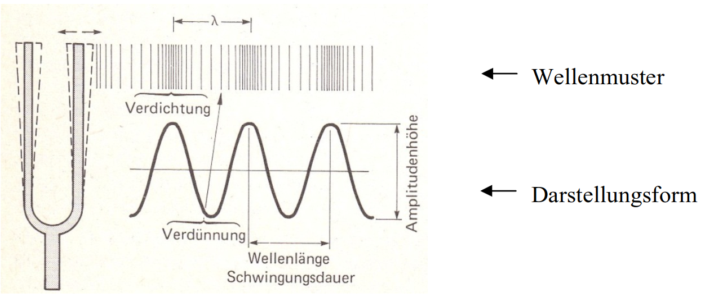

Quelle: Hall, Donald E.: <em>Musikalische Akustik. Ein Handbuch.</em> Main, 1997.

#### Amplitude

- Maß der Auslenkung = Schalldruck
- Angegeben in Dezibel (**dB**) = Logarithmischer Maßstab

 

- Orchesterfortissimo: 90 - 100 dB
- Orchesterpianissimo: 40 - 45 dB
- OpernsängerIn: bis 105 dB (Formanten)

:::{.notes}
Logarithmischer Maßstab (Logarithmus: die Zahl mit der man eine Basiszahl potenzieren
muss, um die vorgegebene Zahl Numerus zu erhalten).
:::

#### Wellenlänge (**λ**)

- Abstand zwischen zwei Wellenhügeln (Druck- oder Verdichtungsmaxima).
- Je größer die Wellenlänge, desto tiefer der Ton.

. . .

$$
Wellenlänge = \frac{Schallgeschwindigkeit}{Frequenz}
$$

. . .

$$
λ = \frac{c}{f}
$$

#### Frequenz (**f**)

- Anzahl der Druckschwankungen bzw. Schwingungen pro Sekunde.
- Gemessen in **Hertz** (=Hz).
- Abhängig von Wellenlänge **λ** und Schallgeschwindigkeit **c** 
- Berechnung bei trockener Luft, 20°C:

. . .

$$
f = \frac{c}{λ}
$$

#### Frequenzbeispiele

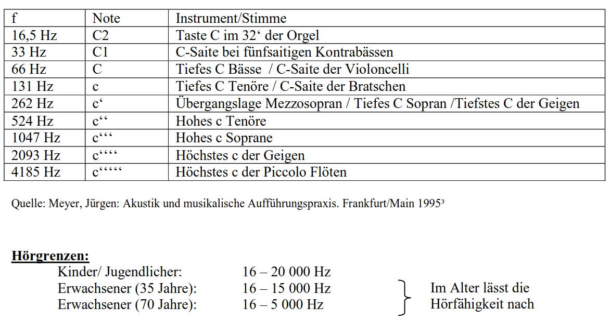

#### Ausnutzung von Hörgrenzen

<iframe data-preload class="r-stretch" src="../assets/Mosquito Flyer (D) Stand 3 2025 DIGI.pdf"></iframe>

Quelle: [Antivandalismus.de](https://www.antivandalismus.de/)

#### Schallgeschwindigkeit (**c**)

- Fortpflanzungsgeschwindigkeit, mit der sich Druckschwankungen über den Luftraum ausbreiten.
- In der Luft u. a. abhängig von der Temperatur, **c** nimmt bei ansteigender Temperatur zu. (Beispiel Freiluftaufführungen, etwa über einem Gewässer.)

#### Schallgeschwindigkeit in verschiedenen Medien

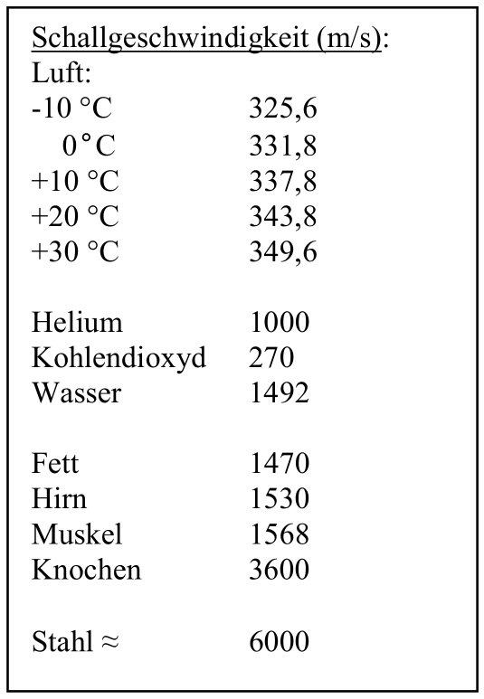{width="35%"}

#### Fragen?

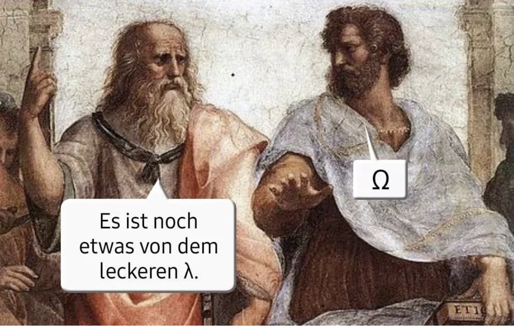{.r-stretch}

## Geschichte der Gesangspädagogik III - Mittelalter {background-image="../assets/degas_la-repetition-de-chant_1877.png" background-opacity="0.4"}

#### Ergänzung Antike

::::{.columns}

:::{.column width="40%"}
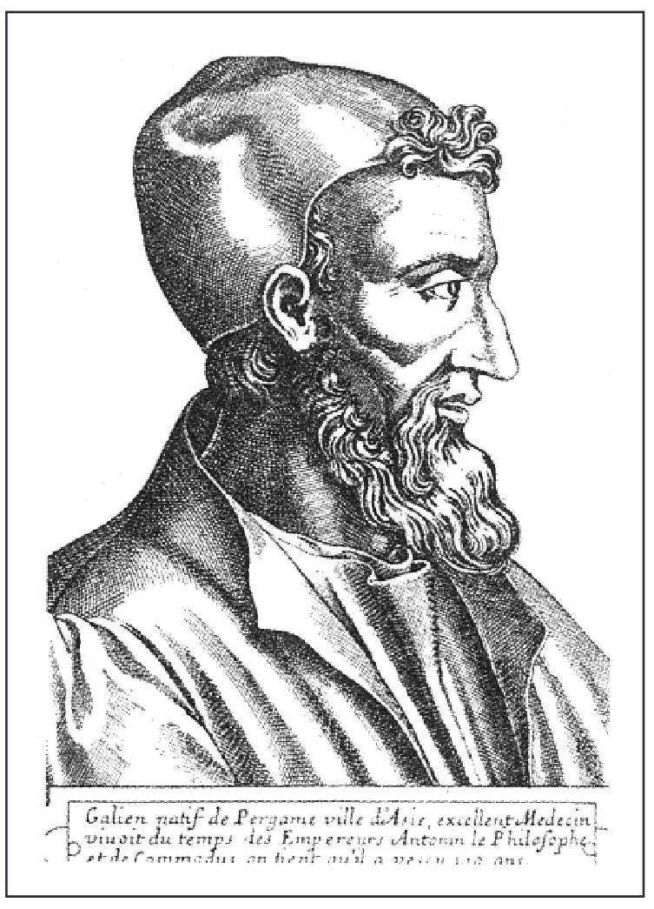

:::{style="font-size: 20px; margin-top: -40px"}
[Claudius Galenus (129-199 u. Z.)]()
:::
:::

:::{.column width="4%"}

:::

:::{.column width="48%" .fragment style="font-size: 0.75em;"}
- Griechischer Anatom, Arzt u. a. in Pergamon, später Rom
- Zunächst u. a. Gladiatorenarzt, später Leibarzt römischer Kaiser (Mark Aurel, Lucius Verus, Commodus u.a.)
- Kehlkopfstudien durch Tiersektionen: Prägt Begriff der *Glottis*
- [*Glottis*]{style="color: red;"} [= Spalt zwischen den beiden Stimmlippen]{.fragment} 
:::

::::

:::{.notes}
- War das Wissen um die physiologischen Vorgänge bei der Stimmgebung in der Antike noch reichlich verschwommen, so begründete erst im 2. Jahrhundert n. Chr. Claudius Galenus (129-199 n. Chr.) (Abb. 1), „der aus Griechenland stammende Leibarzt des römischen Kaisers Marcus Aurelius, die Wissenschaft vom Kehlkopf durch eine Beschreibung der  Stimmbänder, dem bei der Öffnung der Stimmlippen gebildeten Spalt hat er den Namen Glottis gegeben.“2
:::

#### Definition Europäisches "Mittelalter"

::::{.columns}

:::{.column width="48%"}
- Grobe Zeitspanne 500-1500 u. Z.

- Wertende Bezeichnung als *medium aevum* erst später ab der Renaissance

- Europäische Perspektive!
:::

:::{.column width="4%"}
:::

:::{.column width="48%"}
{width="65%"}

:::{style="font-size: 20px; margin-top: -30px"}
[1412-1416](https://de.wikipedia.org/wiki/Tr%C3%A8s_Riches_Heures)
:::
:::

::::

#### Sekundärliteratur

::::{.columns}

:::{.column width="35%"}

:::{style="font-size: 20px; margin-top: -30px"}
[@grout2019]
:::
:::

:::{.column width="20%"}
:::

:::{.column width="35%"}

:::{style="font-size: 20px; margin-top: -30px"}
([Tuchman 1980]())
:::
:::

::::

#### Cantus Romanus (4. bis 9. Jahrhundert)

- Einstimmiger, zunächst unbegleiteter liturgischer Gesang der frühen christlich-römischen Kirche.
- Überwiegend solistisch vorgetragen, später *responsorisch* und *antiphonal*
- Lateinische Texte, überwiegend aus der Bibel und den Psalmen.
- Tief verwurzelt in der jüdischen Tradition (Jubilus, Melismatik)

:::{.notes}
Zentrale Einflüsse aus dem Judentum

In den ersten christlichen Jahrhunderten entstanden unter den Einflüssen der jüdischen Ritualmusik einfache Melodien; deren Vortrag blieb meist auf Solisten beschränkt, die in der Lage waren, alle Verse eines Psalmes in einem Zug vorzutragen. Diese Gesänge waren meist syllabisch, es wurden vereinzelt aber auch schon Melismen verwendet. Am Ende des 4. Jahrhunderts begann die Gemeinde mit einfachen, kurzen Gesängen auf die solistischen Gesänge zu antworten (Responsorium). Mit der Entstehung von Mönchsorden gab es während der Gottesdienste viele Sänger, die die Psalmen auswendig kannten, so dass diese sich regelmäßig in zwei Chöre aufteilen konnten und abwechselnd sangen

• Psalmodie (Psalmenvortrag): Das Singen und Rezitieren von Psalmen auf festen Rezitationstönen (Lektionstönen) mit einfachen Anfangs- und Schlussfloskeln stammt unmittelbar aus der jüdischen Gebetspraxis.
• Responsorial- und Antiphonalgesang: Der Wechselgesang zwischen einem Vorsänger (Kantor) und der Gemeinde (responsorisch) oder zwischen zwei Chören (antiphonal) wurde aus der Synagoge in die römische Liturgie übertragen.
• Kantillation (musikalische Textdeklamation): Die Art, heilige Texte in einem erhöhten, melodischen Sprechgesang vorzutragen, um den Sinn der Worte hervorzuheben, geht auf die jüdische Schriftlesung zurück.
• Jubilus und Melismen: Ausgedehnte Tonfolgen auf einer einzelnen Silbe – besonders beim hebräischen Ausruf Halleluja – haben Vorbilder in den ekstatischen Lobgesängen der jüdischen Tradition.
• Verzicht auf Instrumente: Nach der Zerstörung des Jerusalemer Tempels (70 n. Chr.) verzichtete der synagogale Gottesdienst aus Trauer weitgehend auf Musikinstrumente – ein Prinzip, das der Cantus Romanus mit seiner reinen Vokalmusik übernahm.
:::

#### Melismatik/Syllabik

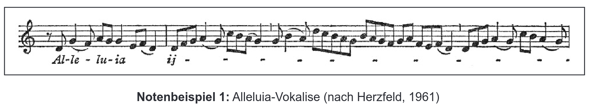

- *Melismatischer* Gesang: Mehrere Töne pro Silbe

- *Syllabischer* Gesang: Ein Ton pro Silbe

#### Gregorianischer Choral

::::{.columns}

:::{.column width="48%" style="font-size: 0.75em;"}
- Zuschreibung an Papst Gregor I. "Der Große" (ca. 540-604) im 9. Jhd.
- Eigentliche Komponisten und Bearbeiter nicht namentlich überliefert
- Gregor I. zugeschrieben: Gründung der ersten päpstlichen *Schola Cantorum* (7 Mitglieder)
:::

:::{.column width="45%"}

:::{style="font-size: 20px; margin-top: -30px"}
ca. 1000
:::
:::

::::

:::{.notes}
• Späte Legendenbildung: Die Zuschreibung an Gregor den Großen taucht erst rund 200 Jahre nach seinem Tod auf. Besonders Johannes Diaconus prägte um 870 in seiner Gregor-Biografie das Bild des Papstes als Schöpfer der Gesänge (oft mit dem Motiv einer Taube, die ihm die Melodien eingibt).
• Politischer Zweck im Frankenreich: Pippin und Karl der Große förderten die Vereinheitlichung der Liturgie nach römischem Vorbild. Die Verbindung zu einem berühmten römischen Papst verlieh dem Repertoire Autorität und Einheitlichkeit.
• Anonyme Entstehung: Die eigentlichen Komponisten und Bearbeiter der Gesänge sind nicht namentlich überliefert; der Choral wuchs über Jahrhunderte durch mündliche Weitergabe und Bearbeitung.

Was wirklich geschah

• Römische Wurzeln: Um das 7./8. Jahrhundert existierte in Rom bereits ein liturgisches Repertoire (oft als altrömischer Choral bezeichnet) und eine Schola cantorum.
• Fränkische Umgestaltung: Ab etwa der Mitte des 8. Jahrhunderts kamen römische Gesänge ins Frankenreich und wurden dort von fränkischen Kantoren umgeformt und weiterentwickelt. Im Vergleich zum altrömischen Repertoire wirkt der gregorianische Choral oft straffer und komprimierter.
• Verschriftlichung: Erst ab dem 9. Jahrhundert setzte eine breitere schriftliche Überlieferung mit Neumen ein, die das Repertoire fixierte.
:::

#### Sänger- und Schreibschulen des mittelalterlichen Chorals

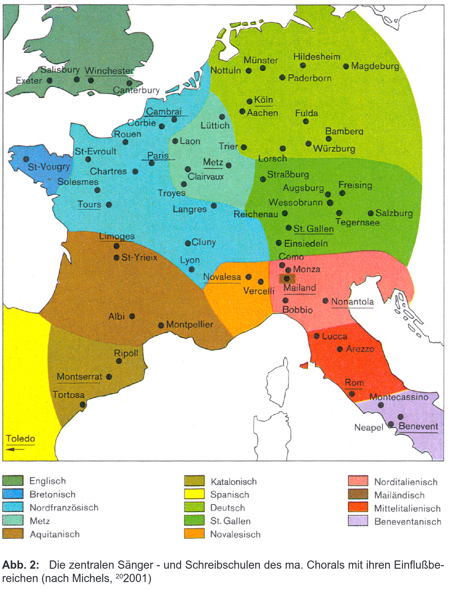{width="40%"}

:::{style="font-size: 20px; margin-top: -30px"}
@fehlow2009
:::

#### Neumen 

- (griechisch νεῦμα *neuma*, deutsch ‚Wink‘)

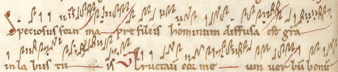{.fragment}

:::{.notes}
EINZELNE TÖNE ODER AUCH TONFOLGEN

Der größte Unterschied der Neumen zu den Noten, die wir heute benutzen: ein Neumen-Zeichen kann nicht nur einen Ton darstellen, sondern auch eine Folge von zwei oder drei Tönen. Die Neumen-Schreiber des Mittelalters schöpften dazu aus einem großen Pool verschiedener Zeichen. Jedes dieser Zeichen steht für eine bestimmte Tonfolge: zum Beispiel gibt es eine spezielle Neume für die Folge Hochton – Tiefton – Hochton, oder eine andere für die Folge tief – höher – noch höher. Die exakte Tonhöhe zeigen die meisten Neumenschriften nicht an.
MÜNDLICH VERSUS SCHRIFTLICH

Warum aber begann man im 9. Jahrhundert, den gregorianischen Choral mit Neumen aufzuschreiben? Die liturgische Musik wurde im frühen Mittelalter mündlich weitergetragen: Die älteren Mönche unterrichteten die jüngeren und brachten ihnen alle Choräle bei. Eigentlich hätte man also diese Gesänge gar nicht aufzeichnen müssen – sie waren bekannt. Nun war es aber so, dass der Choral überall in Europa etwas anders gesungen wurde. Als die Karolinger im 9. Jahrhundert den größten Teil des Kontinents unter ihrer Herrschaft vereinten, wollten sie auch einen einheitlichen Gottesdienst einführen. Sie erklärten den römischen Ritus zur verbindlichen Form und schickten Mönche aus, ihn überall zu lehren.
FÜR DIE EWIGKEIT NOTIERT

Neuerlerntes bleibt nicht so leicht hängen wie das gewohnte – deshalb behalf man sich mit Melodiezeichen als Gedächtnisstütze. Die Neumen waren der Anstoß zu einem Phänomen, das es in dieser Form nur in Europa gibt: einer Musikpraxis, die bis heute auf dem scheinbar widersinnigen Unterfangen beruht, etwas so flüchtiges wie Töne durch Schriftzeichen einfangen zu wollen.
:::

#### Johanneshymnus in moderner Quadratnotation

{.r-stretch}

#### Guido von Arezzo (ca. 992-1050)

::::{.columns}

:::{.column width="50%" .fragment style="font-size: 0.75em;"}
- Benediktinermönch und Musiktheoretiker
- Hauptwerk *Micrologus de disciplina artis musicae* (Kirchentonarten und Intervalle)
- Entwickelt Musiknotation basierend auf vier Linien im Terzabstand
:::

:::{.column width="50%"}

:::

::::

:::{.notes}
- Monochord
:::

#### Hexachorde

- Grundlage/Tonvorrat zum Erlernen der gregorianischen Choräle

- Folge von sechs Tönen von C, F oder G ausgehend
- 2 Ganztonschritte, 1 Halbtonschritt, 2 Ganztonschritte 

 

- *hexachordum naturale* (natürliches Hexachord) C-D-E-F-G-A
- *hexachordum molle* (weiches Hexachord) F-G-A-B-C-D
- *hexachordum durum* (hartes Hexachord) G-A-H-C-D-E.

#### Johanneshymnus in moderner Quadratnotation

{.r-stretch}

#### Solmisationssilben aus dem Johanneshymnus {.smaller}

 

| Tonsilbe             | Lateinischer Text       | Deutsche Übersetzung                 |
| -------------------- | ----------------------- | ------------------------------------ |
| **Ut** _(später Do)_ | **Ut** queant laxis     | Auf dass mit lockeren (Stimmbändern) |
| **Re**               | **re**sonare fibris     | zum Klingen bringen können           |
| **Mi**               | **Mi**ra gestorum       | die Wunder deiner Taten              |
| **Fa**               | **fa**muli tuorum,      | deine Diener,                        |
| **Sol**              | **Sol**ve polluti       | löse der befleckten                  |
| **La**               | **la**bii reatum,       | Lippe Schuld,                        |
| **Si** _(ergänzt)_   | **S**ancte **I**oannes. | Heiliger Johannes.                   |

#### Guidonische Hand (Arezzo nur zugeschrieben)

{.r-stretch}

#### Moderne Darstellung

## Akustik II {background-color="#0FA3B1"}

#### Kammerton {.smaller} 

. . .

a' = **440 Hz** 

- Festgelegt 1939 auf der Internationalen Stimmtonkonferenz in London. 
- Früher Abgrenzung Kammerton zu Chor-/Orgelton. 
- Orchesterstimmton 443 Hz (Deutschland/Österreich), 442 Hz (Schweiz/Italien )
- Übliche, historisch orientierte Stimmtöne: 
    - 415 Hz (Barock) 
    - 430 Hz (Klassik) 
    - 438 Hz (Romantik)

- Tendenz geht in Richtung zunehmend höherer Stimmtöne (Brillanz Streicher u. a.)
- Zu schnelle Entwicklung für die menschliche Stimme. 
- Fortwährende Evolution Richtung tiefere Stimme?

#### Überlagerung von (Schall-)Wellen (Interferenz)

- **Achtung**: Grafische Darstellung von Longitudinalwellen (Schall) in der Regel als Transversalwelle!

- Verschiedene Schallwellen stören sich nicht, sondern addieren sich zu einer neuen Schallwelle.

#### Überlagerung von Teiltönen zu einem Klang

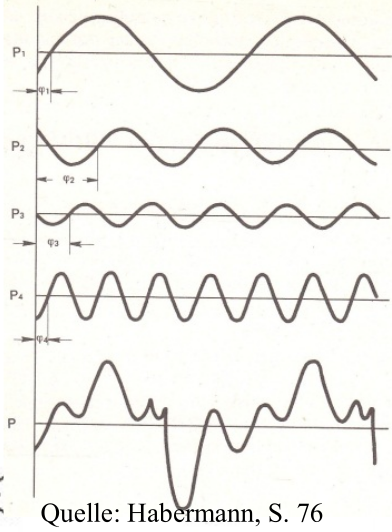{.r-stretch .lightbox}

#### Unterschied Ton, Klang, Geräusch



:::{style="font-size: 20px; margin-top: -60px"}
physikdigital • de, Reg. Was ist der Unterschied zwischen einem Ton, einem Klang und einem Geräusch. 2018.
^[physikdigital • de, Reg. Was ist der Unterschied zwischen einem Ton, einem Klang und einem Geräusch (physikdigital.de). 2018. 1:34. https://www.youtube.com/watch?v=8fwpYBSM-JA.]
:::

#### {.smaller}

**Ton**

- Einzelne Schwingung ohne weitere Überlagerung von Teilschwingungen. Oft als (künstlich erzeugte) Sinusschwingung dargestellt.

. . .

**Klang**

- Komplexe Überlagerung mehrerer Einzelschwingungen. Im Vergleich zur Sinusschwingung komplexere Wellenform, aber regelmäßig (**Periodizität**).

. . .

**Geräusch**

- Komplexe Überlagerung von Einzelschwingungen in "chaotischem" Muster. **Keine** Periodizität in Wellenlänge, Frequenz etc.

####



:::{style="font-size: 20px; margin-top: -60px"}
F. KTM - HLS Hannover, Reg. Akustik: Der Unterschied zwischen Ton, Klang und Geräusch. Was ist Klangfarbe? 2021.
^[F. KTM - HLS Hannover, Reg. Akustik: Der Unterschied zwischen Ton, Klang und Geräusch. Was ist Klangfarbe? 2021. 3:28. https://www.youtube.com/watch?v=3JUvuLpnedk.
]
:::

#### Resonanz {.smaller}

- _sonare_ = klingen, schwingen
- _resonare_ = widerklingen, mitschwingen

- Ein elastischer Körper wird von einem anderen, schwingenden Medium zur Schwingung angeregt. 
- Besonders stark, wenn externe Schwingung der **Eigenfrequenz** entspricht.

. . .

Beispiele:

- Akustik: Ansatzraum, Luft im Bronchialraum, Knochen+Gewebe, Klaviersaite, Snare (Drumset)
- Mechanik: Kinderschaukel, Suppenteller auf Tablett

#### Primärschall

- Schallsignal, das direkt oberhalb der Stimmlippen entsteht.

- Vergleich: Trompetenmundstück ohne Korpus.

- Ziel im klassischen Gesang: Möglichst komplexes (u. a. grund-/obertonreiches) Signal.

- Schall-/Vibrationsempfindungen im Körper während der Phonation (z. B. im Brustkorb) **sekundäre** Schwingungen.

:::{.notes}
Bei der Stimmbildung versetzt die aus der Lunge strömende Luft die Stimmlippen in Schwingung. Dabei schließen sich die beiden Stimmlippen in der Mittellinie (Adduktion) und die Luft strömt durch den schmalen Spalt, die Rima glottidis. Der entstehende Unterdruck nach dem Bernoulli-Prinzip führt zum rhythmischen Öffnen und Schließen der Stimmlippen, wodurch periodische Druckwellen erzeugt werden. Hierbei handelt es sich um den sogenannten Primärschall.

Dieser Primärschall wird anschließend durch die Resonanzräume des Rachens, des Mundes und der Nasenhöhle moduliert und als artikulierter Laut wahrgenommen. Die Tonhöhe ergibt sich aus der Spannung, Länge und Masse der Stimmlippen. Sie wird beeinflusst durch muskuläre Aktivität, vor allem durch den Musculus cricothyroideus und den Musculus vocalis.
:::

#### Resonanzräume {.smaller}

- **Klangformung** im Wesentlichen in allen Räumen oberhalb der Stimmlippen zu äußeren Lippen
   - Larynxeingang, Pharynxschlauch, Mundhöhle/Zunge, Lippen
   - Nasenraum? (außer bei Nasalen durch Gaumensegel und Passavant'schen Wulst verschlossen)

- Durchschnittliche **Länge**: Männer ca. 17,5 cm, Frauen ca. 15 cm

- Uneinheitliche **Benennung**: Vokaltrakt, Ansatzräume, Ansatzrohr, Artikulations- / Resonanzraum ...

- Sollen Orte empfundener sekundärer Schwingung (Brustkorb, "Vordersitz", "Maske") zu Resonanzräumen gezählt werden?

#### Resonanzräume

.png)

#### Vokaltrakt in 3D

.png)

#### Resonanzräume ggü. Vibrationsempfindung

. . .

::::{.columns}

:::{.column width="50%"}
.png){width="50%"}
:::

:::{.column width="50%" .fragment}
.png)
:::

::::

#### Vibrationsempfindung (Lilli Lehmann 1913)

.png)

#### Teiltöne, Partialtöne, Obertöne

- Durch Reflexionen entstehen Überlagerungen. Eine Saite oder Stimmlippe schwingt gleichzeitig nicht nur in der vollen Länge, sondern auch in der Hälfte, im Drittel etc.

- U. a. dadurch entstehen die **Teiltöne**, auch Partialtöne (inklusive des Grundtons!) oder Obertöne genannt.

#### Teilton-/Obertonreihe

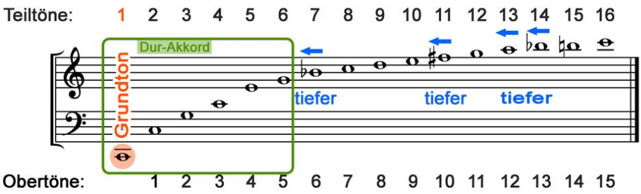{width="80%"}

- Bei der Zählung beachten: Der Grundton ist 1. Teilton, aber nicht 1. Oberton (sondern quasi „nullter“= F0, Grundtonfrequenz). 

- Obertöne sind alle Töne oberhalb des Grundtons. Die Nummerierung der Obertöne ist daher immer um 1 niedriger als die der Teiltöne.

#### Faktoren für Anzahl/Ausprägung der Obertöne

- F0: Frequenz des Grundtons (=Grundfrequenz)
- Amplitude/Lautstärke
- Register auf Larynxebene (Voll-/Randstimme, Falsett etc.)
- Stimmschluss (Schlussquotient u. a.)
- Unterschiede Frauen-/Männerstimme?

#### Software-Empfehlung für Visualisierung der Stimme

- KTH Stockholm:
   - RTSect (Schallspektrum)
   - Madde (Stimmsynthesizer)

. . .

Download kostenfrei unter [www.tolvan.com](www.tolvan.com)

#### Spektografie Bariton [a] 200 Hz (RTsect)

.png)

#### Formanten

- Vokaltrakt: "Resonator mit Filterwirkung" (Richter 2012)
- Überträgt bestimmte Frequenzen besser als andere.
- Amplitude der Obertöne nahe der Resonanzfrequenzen besonders groß. 
- Diese Vokaltraktresonanzen werden **Formanten** (lat. _formans_ = bildend) genannt.
   - Spitzen / Peaks akustischer Energie

#### Wichtigste Formanten des Ansatzrohrs

- Fünf **Formanten F1-F5** für den menschlichen  Stimmklang relevant.
   - **F1** und **F2**: Erkennbarkeit und Qualität der Vokale (**Vokalformanten**).
   - **F3 - F5**: Timbre (persönlicher Stimmklang) und **Tragfähigkeit** der Stimme.

- Die Formantfrequenzen sind von der **Länge** und **Weite** des Ansatzrohres abhängig. 

- Besonders die Weite ist stark abhängig von Kiefer- und Lippenöffnung sowie Zungenform.

#### Vokalformanten F1 + F2

.png)

#### Fragen?

#### Quellen/Medien